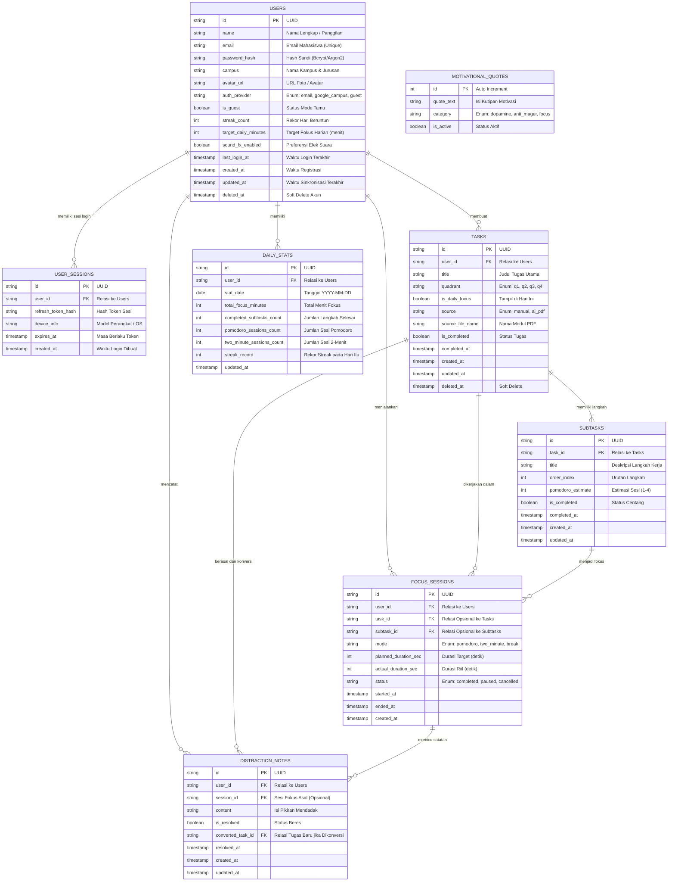

# Entity Relationship Diagram (ERD) & Spesifikasi Database — Fokuscuy (FocusMate)

Dokumen ini merancang arsitektur database yang optimal, ringan, dan siap pakai untuk aplikasi **Fokuscuy**. Desain ini dirancang khusus untuk mendukung arsitektur **Offline-First** (Room SQLite di Android) dan kompatibel jika dihubungkan ke database cloud (PostgreSQL / Supabase / Payload).

---

## 1. Diagram Relasi Entitas Lengkap (Mermaid ERD)



---

## 2. Rincian Kamus Data (Data Dictionary)

### 2.1 Tabel `users` (Profil & Kredensial Pengguna)
Menyimpan data profil, autentikasi, status mahasiswa, dan konfigurasi aplikasi.
| Nama Kolom | Tipe Data | Keterangan & Batasan |
| :--- | :--- | :--- |
| `id` | `VARCHAR(36)` | **PRIMARY KEY** (UUID v4). |
| `name` | `VARCHAR(100)` | Nama lengkap atau panggilan pengguna (cth: "Dimas Pratama"). |
| `email` | `VARCHAR(255)` | **UNIQUE NOT NULL**. Email mahasiswa atau pribadi. |
| `password_hash` | `VARCHAR(255)` | Hash kata sandi terenkripsi (NULL jika login via Google SSO atau Tamu). |
| `campus` | `VARCHAR(255)` | Nama universitas dan jurusan (cth: "Teknik Informatika - Univ. Brawijaya"). |
| `avatar_url` | `VARCHAR(500)` | URL avatar kustom atau generator inisial. |
| `auth_provider` | `VARCHAR(30)` | `CHECK(auth_provider IN ('email', 'google_campus', 'guest'))`. |
| `is_guest` | `BOOLEAN` | Status mode tamu tanpa akun permanen (default: `FALSE`). |
| `streak_count` | `INTEGER` | Jumlah hari berturut-turut fokus (default: `0`). |
| `target_daily_minutes` | `INTEGER` | Target harian dalam menit (default: `100`). |
| `sound_fx_enabled` | `BOOLEAN` | Toggle efek suara sintetis Web Audio API (default: `TRUE`). |
| `last_login_at` | `TIMESTAMP` | Waktu login terakhir untuk melacak aktivitas. |
| `created_at` | `TIMESTAMP` | Waktu registrasi akun pertama kali. |
| `updated_at` | `TIMESTAMP` | Waktu pembaruan data terakhir (acuan sync). |
| `deleted_at` | `TIMESTAMP` | Mendukung *Soft Delete* akun (NULL jika aktif). |

---

### 2.2 Tabel `user_sessions` (Manajemen Sesi Autentikasi)
Menangani token sesi multi-perangkat (*multi-device tokens*), refresh token, dan riwayat perangkat.
| Nama Kolom | Tipe Data | Keterangan & Batasan |
| :--- | :--- | :--- |
| `id` | `VARCHAR(36)` | **PRIMARY KEY** (UUID v4). |
| `user_id` | `VARCHAR(36)` | **FOREIGN KEY** $\rightarrow$ `users(id)` ON DELETE CASCADE. |
| `refresh_token_hash`| `VARCHAR(255)` | **UNIQUE NOT NULL**. Hash token sesi aman. |
| `device_info` | `VARCHAR(150)` | Identitas perangkat (cth: "Android 14 - Samsung Galaxy A54"). |
| `expires_at` | `TIMESTAMP` | Waktu kedaluwarsa sesi login (cth: +30 hari). |
| `created_at` | `TIMESTAMP` | Waktu sesi dibuat saat berhasil masuk. |

---

### 2.2 Tabel `tasks`
Entitas tugas utama yang dipetakan ke dalam 4 Kuadran Matriks Eisenhower.
| Nama Kolom | Tipe Data | Keterangan & Batasan |
| :--- | :--- | :--- |
| `id` | `VARCHAR(36)` | **PRIMARY KEY** (UUID v4). |
| `user_id` | `VARCHAR(36)` | **FOREIGN KEY** $\rightarrow$ `users(id)` ON DELETE CASCADE. |
| `title` | `VARCHAR(255)` | Judul tugas utama (NOT NULL). |
| `quadrant` | `VARCHAR(10)` | `CHECK(quadrant IN ('q1', 'q2', 'q3', 'q4'))`. |
| `is_daily_focus` | `BOOLEAN` | Menandai apakah tugas tampil di dashboard "Hari Ini" (default: `FALSE`). |
| `source` | `VARCHAR(20)` | `CHECK(source IN ('manual', 'ai_pdf'))`. |
| `source_file_name` | `VARCHAR(255)` | Nama dokumen PDF asli jika diurai oleh AI Llama 3. |
| `is_completed` | `BOOLEAN` | Nilai `TRUE` jika semua subtask selesai (default: `FALSE`). |
| `completed_at` | `TIMESTAMP` | Waktu tugas utama dinyatakan selesai seluruhnya. |
| `created_at` | `TIMESTAMP` | Waktu pembuatan tugas. |
| `updated_at` | `TIMESTAMP` | Waktu perubahan terakhir (sinkronisasi). |
| `deleted_at` | `TIMESTAMP` | Mendukung *Soft Delete* (NULL jika aktif). |

---

### 2.3 Tabel `subtasks`
Langkah-langkah kecil hasil dekomposisi tugas (3–5 langkah terukur).
| Nama Kolom | Tipe Data | Keterangan & Batasan |
| :--- | :--- | :--- |
| `id` | `VARCHAR(36)` | **PRIMARY KEY** (UUID v4). |
| `task_id` | `VARCHAR(36)` | **FOREIGN KEY** $\rightarrow$ `tasks(id)` ON DELETE CASCADE. |
| `title` | `VARCHAR(255)` | Deskripsi langkah aksi spesifik. |
| `order_index` | `INTEGER` | Urutan langkah pengerjaan (1, 2, 3, ...). |
| `pomodoro_estimate` | `INTEGER` | Estimasi jumlah sesi Pomodoro (1 s/d 4 sesi). |
| `is_completed` | `BOOLEAN` | Status penyelesaian langkah (default: `FALSE`). |
| `completed_at` | `TIMESTAMP` | Waktu centang sub-tugas. |
| `created_at` | `TIMESTAMP` | Waktu pembuatan langkah. |
| `updated_at` | `TIMESTAMP` | Waktu perubahan langkah. |

---

### 2.4 Tabel `focus_sessions`
Riwayat pencatatan setiap kali timer dijalankan (*Zen Engine Log*).
| Nama Kolom | Tipe Data | Keterangan & Batasan |
| :--- | :--- | :--- |
| `id` | `VARCHAR(36)` | **PRIMARY KEY** (UUID v4). |
| `user_id` | `VARCHAR(36)` | **FOREIGN KEY** $\rightarrow$ `users(id)`. |
| `task_id` | `VARCHAR(36)` | **FOREIGN KEY** $\rightarrow$ `tasks(id)` (Bisa NULL jika sesi bebas). |
| `subtask_id` | `VARCHAR(36)` | **FOREIGN KEY** $\rightarrow$ `subtasks(id)` (Bisa NULL). |
| `mode` | `VARCHAR(20)` | `CHECK(mode IN ('pomodoro', 'two_minute', 'break'))`. |
| `planned_duration_sec`| `INTEGER` | 1500 (25m), 120 (2m), atau 300 (5m). |
| `actual_duration_sec` | `INTEGER` | Detik riil yang berhasil dijalankan pengguna. |
| `status` | `VARCHAR(20)` | `CHECK(status IN ('completed', 'paused', 'cancelled'))`. |
| `started_at` | `TIMESTAMP` | Waktu tombol "Mulai Fokus" ditekan. |
| `ended_at` | `TIMESTAMP` | Waktu sesi selesai atau dihentikan. |
| `created_at` | `TIMESTAMP` | Waktu pembuatan entri log. |

---

### 2.5 Tabel `distraction_notes` (*Brankas Parkir Pikiran*)
Menyimpan ide atau distraksi yang muncul saat pengguna sedang dalam mode fokus tanpa menghentikan timer.
| Nama Kolom | Tipe Data | Keterangan & Batasan |
| :--- | :--- | :--- |
| `id` | `VARCHAR(36)` | **PRIMARY KEY** (UUID v4). |
| `user_id` | `VARCHAR(36)` | **FOREIGN KEY** $\rightarrow$ `users(id)`. |
| `session_id` | `VARCHAR(36)` | **FOREIGN KEY** $\rightarrow$ `focus_sessions(id)` (Bisa NULL). |
| `content` | `TEXT` | Teks pikiran kilat yang diparkir. |
| `is_resolved` | `BOOLEAN` | Status apakah sudah ditangani atau dihapus (default: `FALSE`). |
| `converted_task_id` | `VARCHAR(36)` | **FOREIGN KEY** $\rightarrow$ `tasks(id)` jika diubah jadi tugas di Matriks. |
| `resolved_at` | `TIMESTAMP` | Waktu catatan diselesaikan / dikonversi. |
| `created_at` | `TIMESTAMP` | Waktu catatan diparkir. |
| `updated_at` | `TIMESTAMP` | Waktu catatan disunting. |

---

### 2.6 Tabel `daily_stats`
Tabel agregasi harian untuk mempercepat rendering visual grafik mingguan pada Tab Statistik tanpa *heavy query*.
| Nama Kolom | Tipe Data | Keterangan & Batasan |
| :--- | :--- | :--- |
| `id` | `VARCHAR(36)` | **PRIMARY KEY** (UUID v4). |
| `user_id` | `VARCHAR(36)` | **FOREIGN KEY** $\rightarrow$ `users(id)`. |
| `stat_date` | `DATE` | Tanggal agregasi (YYYY-MM-DD). **UNIQUE(user_id, stat_date)**. |
| `total_focus_minutes` | `INTEGER` | Akumulasi durasi fokus efektif pada hari tersebut. |
| `completed_subtasks_count`| `INTEGER` | Total langkah yang dicentang hari itu. |
| `pomodoro_sessions_count` | `INTEGER` | Jumlah sesi 25 menit yang tuntas. |
| `two_minute_sessions_count`| `INTEGER`| Jumlah sesi 2 menit yang dieksekusi. |
| `streak_record` | `INTEGER` | Catatan streak pada akhir hari. |
| `updated_at` | `TIMESTAMP` | Waktu kalkulasi terakhir. |

---

### 2.7 Tabel `motivational_quotes`
Koleksi kutipan offline untuk kartu *Daily Spark* di Tab Hari Ini.
| Nama Kolom | Tipe Data | Keterangan & Batasan |
| :--- | :--- | :--- |
| `id` | `INTEGER` | **PRIMARY KEY AUTOINCREMENT**. |
| `quote_text` | `TEXT` | Isi pesan motivasi non-judgmental. |
| `category` | `VARCHAR(50)` | Kategori kutipan (dopamine, anti_mager, focus). |
| `is_active` | `BOOLEAN` | Status aktif rotasi harian (default: `TRUE`). |

---

## 3. Strategi Pengindeksan (Indexing Strategy)

Untuk menjamin kecepatan kueri di bawah 16ms (*60fps smooth scrolling* di Android):

```sql
-- 1. Indexing untuk Dashboard Tab "Hari Ini"
CREATE INDEX idx_tasks_daily_focus ON tasks (user_id, is_daily_focus, is_completed) WHERE deleted_at IS NULL;
CREATE INDEX idx_tasks_quadrant ON tasks (user_id, quadrant, is_completed) WHERE deleted_at IS NULL;

-- 2. Indexing untuk Subtasks per Tugas
CREATE INDEX idx_subtasks_task_order ON subtasks (task_id, order_index);

-- 3. Indexing untuk Brankas Parkir Pikiran
CREATE INDEX idx_distractions_active ON distraction_notes (user_id, is_resolved, created_at DESC);

-- 4. Indexing untuk Grafik Statistik Mingguan
CREATE INDEX idx_daily_stats_lookup ON daily_stats (user_id, stat_date DESC);
```

---

## 4. Skrip DDL Lengkap (SQLite / PostgreSQL Compatible)

```sql
-- 1. USERS
CREATE TABLE IF NOT EXISTS users (
    id VARCHAR(36) PRIMARY KEY,
    name VARCHAR(100) NOT NULL,
    email VARCHAR(255) UNIQUE NOT NULL,
    password_hash VARCHAR(255),
    campus VARCHAR(255),
    avatar_url VARCHAR(500),
    auth_provider VARCHAR(30) DEFAULT 'email' NOT NULL CHECK(auth_provider IN ('email', 'google_campus', 'guest')),
    is_guest BOOLEAN DEFAULT FALSE NOT NULL,
    streak_count INTEGER DEFAULT 0 NOT NULL,
    target_daily_minutes INTEGER DEFAULT 100 NOT NULL,
    sound_fx_enabled BOOLEAN DEFAULT TRUE NOT NULL,
    last_login_at TIMESTAMP,
    created_at TIMESTAMP DEFAULT CURRENT_TIMESTAMP NOT NULL,
    updated_at TIMESTAMP DEFAULT CURRENT_TIMESTAMP NOT NULL,
    deleted_at TIMESTAMP
);

-- 1B. USER_SESSIONS (Autentikasi Multi-Perangkat)
CREATE TABLE IF NOT EXISTS user_sessions (
    id VARCHAR(36) PRIMARY KEY,
    user_id VARCHAR(36) NOT NULL,
    refresh_token_hash VARCHAR(255) UNIQUE NOT NULL,
    device_info VARCHAR(150),
    expires_at TIMESTAMP NOT NULL,
    created_at TIMESTAMP DEFAULT CURRENT_TIMESTAMP NOT NULL,
    FOREIGN KEY (user_id) REFERENCES users(id) ON DELETE CASCADE
);

-- 2. TASKS
CREATE TABLE IF NOT EXISTS tasks (
    id VARCHAR(36) PRIMARY KEY,
    user_id VARCHAR(36) NOT NULL,
    title VARCHAR(255) NOT NULL,
    quadrant VARCHAR(10) NOT NULL CHECK(quadrant IN ('q1', 'q2', 'q3', 'q4')),
    is_daily_focus BOOLEAN DEFAULT FALSE NOT NULL,
    source VARCHAR(20) DEFAULT 'manual' NOT NULL CHECK(source IN ('manual', 'ai_pdf')),
    source_file_name VARCHAR(255),
    is_completed BOOLEAN DEFAULT FALSE NOT NULL,
    completed_at TIMESTAMP,
    created_at TIMESTAMP DEFAULT CURRENT_TIMESTAMP NOT NULL,
    updated_at TIMESTAMP DEFAULT CURRENT_TIMESTAMP NOT NULL,
    deleted_at TIMESTAMP,
    FOREIGN KEY (user_id) REFERENCES users(id) ON DELETE CASCADE
);

-- 3. SUBTASKS
CREATE TABLE IF NOT EXISTS subtasks (
    id VARCHAR(36) PRIMARY KEY,
    task_id VARCHAR(36) NOT NULL,
    title VARCHAR(255) NOT NULL,
    order_index INTEGER DEFAULT 1 NOT NULL,
    pomodoro_estimate INTEGER DEFAULT 1 NOT NULL CHECK(pomodoro_estimate BETWEEN 1 AND 4),
    is_completed BOOLEAN DEFAULT FALSE NOT NULL,
    completed_at TIMESTAMP,
    created_at TIMESTAMP DEFAULT CURRENT_TIMESTAMP NOT NULL,
    updated_at TIMESTAMP DEFAULT CURRENT_TIMESTAMP NOT NULL,
    FOREIGN KEY (task_id) REFERENCES tasks(id) ON DELETE CASCADE
);

-- 4. FOCUS_SESSIONS
CREATE TABLE IF NOT EXISTS focus_sessions (
    id VARCHAR(36) PRIMARY KEY,
    user_id VARCHAR(36) NOT NULL,
    task_id VARCHAR(36),
    subtask_id VARCHAR(36),
    mode VARCHAR(20) NOT NULL CHECK(mode IN ('pomodoro', 'two_minute', 'break')),
    planned_duration_sec INTEGER NOT NULL,
    actual_duration_sec INTEGER NOT NULL,
    status VARCHAR(20) NOT NULL CHECK(status IN ('completed', 'paused', 'cancelled')),
    started_at TIMESTAMP NOT NULL,
    ended_at TIMESTAMP NOT NULL,
    created_at TIMESTAMP DEFAULT CURRENT_TIMESTAMP NOT NULL,
    FOREIGN KEY (user_id) REFERENCES users(id) ON DELETE CASCADE,
    FOREIGN KEY (task_id) REFERENCES tasks(id) ON DELETE SET NULL,
    FOREIGN KEY (subtask_id) REFERENCES subtasks(id) ON DELETE SET NULL
);

-- 5. DISTRACTION_NOTES (Parkir Pikiran)
CREATE TABLE IF NOT EXISTS distraction_notes (
    id VARCHAR(36) PRIMARY KEY,
    user_id VARCHAR(36) NOT NULL,
    session_id VARCHAR(36),
    content TEXT NOT NULL,
    is_resolved BOOLEAN DEFAULT FALSE NOT NULL,
    converted_task_id VARCHAR(36),
    resolved_at TIMESTAMP,
    created_at TIMESTAMP DEFAULT CURRENT_TIMESTAMP NOT NULL,
    updated_at TIMESTAMP DEFAULT CURRENT_TIMESTAMP NOT NULL,
    FOREIGN KEY (user_id) REFERENCES users(id) ON DELETE CASCADE,
    FOREIGN KEY (session_id) REFERENCES focus_sessions(id) ON DELETE SET NULL,
    FOREIGN KEY (converted_task_id) REFERENCES tasks(id) ON DELETE SET NULL
);

-- 6. DAILY_STATS
CREATE TABLE IF NOT EXISTS daily_stats (
    id VARCHAR(36) PRIMARY KEY,
    user_id VARCHAR(36) NOT NULL,
    stat_date DATE NOT NULL,
    total_focus_minutes INTEGER DEFAULT 0 NOT NULL,
    completed_subtasks_count INTEGER DEFAULT 0 NOT NULL,
    pomodoro_sessions_count INTEGER DEFAULT 0 NOT NULL,
    two_minute_sessions_count INTEGER DEFAULT 0 NOT NULL,
    streak_record INTEGER DEFAULT 0 NOT NULL,
    updated_at TIMESTAMP DEFAULT CURRENT_TIMESTAMP NOT NULL,
    CONSTRAINT uq_user_daily_stat UNIQUE (user_id, stat_date),
    FOREIGN KEY (user_id) REFERENCES users(id) ON DELETE CASCADE
);

-- 7. MOTIVATIONAL_QUOTES
CREATE TABLE IF NOT EXISTS motivational_quotes (
    id INTEGER PRIMARY KEY AUTOINCREMENT,
    quote_text TEXT NOT NULL,
    category VARCHAR(50) DEFAULT 'dopamine' NOT NULL,
    is_active BOOLEAN DEFAULT TRUE NOT NULL
);
```

---

## 5. Fitur Sinkronisasi Offline-First (*Data Sync Pattern*)

Jika aplikasi menggunakan arsitektur Room SQLite di Android yang bersinkronisasi dengan Cloud:
1. **Soft Delete (`deleted_at`):** Data yang dihapus tidak langsung di-DROP agar proses sinkronisasi server mengetahui data mana yang harus dihapus di sisi cloud.
2. **Timestamp Presisi (`updated_at`):** Digunakan untuk resolusi konflik *Last-Write-Wins (LWW)*.
3. **UUID sebagai Primary Key:** Mencegah terjadinya tabrakan ID (*collision*) saat pengguna membuat tugas dalam keadaan luring (*offline*) di perangkat lokal.
