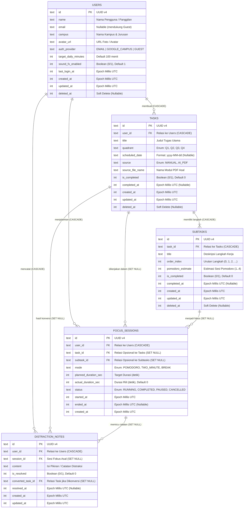

# Entity Relationship Diagram (ERD) & Spesifikasi Database — FokusCuy (v2)

Dokumen ini merancang arsitektur database lokal (Room SQLite) yang optimal, ringan, dan aman untuk aplikasi **FokusCuy**, serta siap disinkronisasikan ke backend cloud (PostgreSQL / Supabase) di masa mendatang.

---

## 1. Diagram Relasi Entitas (Mermaid ERD v2)

---

## 2. Keputusan Arsitektur & Perbaikan ERD v2

Berdasarkan audit keamanan dan performa, berikut penyesuaian dari skema awal:

1. **Keamanan Kredensial (S1)**: `password_hash` dan tabel `user_sessions` **tidak disimpan di SQLite lokal**. Kredensial akun dan refresh token dikelola via Android Keystore / EncryptedSharedPreferences atau diverifikasi oleh auth server.
2. **Fleksibilitas Kalender (F1)**: Penggantian `is_daily_focus` (boolean) menjadi `scheduled_date` (ISO `yyyy-MM-dd`). Ini mendukung pemilihan hari pada strip kalender mingguan.
3. **Dukungan Guest Tanpa Konflik (F2)**: Kolom `users.email` dibuat *nullable* agar mode Guest dapat langsung beroperasi tanpa melanggar constraint unik.
4. **Pencatatan Sesi Berjalan (F3)**: `focus_sessions.ended_at` bernilai *nullable* dengan status `RUNNING`, sehingga aplikasi dapat menyimpan sesi aktif bahkan bila sistem operasi mematikan proses di latar belakang.
5. **Kalkulasi Streak Murni (F4)**: Kolom duplikat `streak_count` dihapus dari tabel; streak dihitung dinamis menggunakan `StreakCalculator` berdasarkan riwayat sesi fokus yang tuntas.
6. **Konsistensi Atomik (F5 & F6)**: Kolom `is_completed` pada `tasks` selalu diperbarui secara atomik di dalam `database.withTransaction` setiap kali status langkah (`subtasks`) berubah. `subtasks.deleted_at` ditambahkan untuk mendukung sinkronisasi LWW (Last-Write-Wins).
7. **Kompatibilitas Room & Indeks (O1 - O4)**:
   - Menggunakan indeks standar SQLite (tanpa klausa parsial `WHERE`) yang diapit filter `@Query`.
   - Menambahkan indeks pada seluruh kolom Foreign Key anak (`task_id`, `subtask_id`, `session_id`, `converted_task_id`) untuk mencegah *full table scan* saat trigger `ON DELETE SET NULL`.
   - Seluruh penanda waktu menggunakan epoch milliseconds UTC (`INTEGER`/`Long`).

---

## 3. Kamus Data & Indeks Ruang Penyimpanan

### 3.1. Tabel `users`
| Kolom | Tipe SQLite | Keterangan |
| :--- | :--- | :--- |
| `id` | `TEXT` | PK, UUID v4 |
| `name` | `TEXT` | Nama pengguna / panggilan (maks 100 karakter) |
| `email` | `TEXT` | Nullable, email login |
| `campus` | `TEXT` | Nullable, identitas kampus & jurusan |
| `avatar_url` | `TEXT` | Nullable, path / URL avatar |
| `auth_provider` | `TEXT` | `EMAIL`, `GOOGLE_CAMPUS`, `GUEST` |
| `target_daily_minutes`| `INTEGER` | Target menit harian (default 100) |
| `sound_fx_enabled` | `INTEGER` | 1 = aktif, 0 = nonaktif |
| `last_login_at` | `INTEGER` | Nullable, epoch millis |
| `created_at` | `INTEGER` | Waktu dibuat, epoch millis |
| `updated_at` | `INTEGER` | Waktu diperbarui, epoch millis |
| `deleted_at` | `INTEGER` | Nullable, soft delete |

### 3.2. Tabel `tasks`
| Kolom | Tipe SQLite | Keterangan |
| :--- | :--- | :--- |
| `id` | `TEXT` | PK, UUID v4 |
| `user_id` | `TEXT` | FK `users.id` (ON DELETE CASCADE) |
| `title` | `TEXT` | Judul tugas (maks 255 karakter) |
| `quadrant` | `TEXT` | `Q1`, `Q2`, `Q3`, `Q4` |
| `scheduled_date` | `TEXT` | Nullable, ISO `yyyy-MM-dd` |
| `source` | `TEXT` | `MANUAL`, `AI_PDF` |
| `source_file_name` | `TEXT` | Nullable, nama berkas PDF asal |
| `is_completed` | `INTEGER` | 0 = belum, 1 = tuntas |
| `completed_at` | `INTEGER` | Nullable, epoch millis |
| `created_at` | `INTEGER` | Waktu dibuat, epoch millis |
| `updated_at` | `INTEGER` | Waktu diperbarui, epoch millis |
| `deleted_at` | `INTEGER` | Nullable, soft delete |

*Indeks:*
- `tasks_user_id_scheduled_date_is_completed`: untuk query cepat tab "Hari Ini" berdasarkan tanggal.
- `tasks_user_id_quadrant_is_completed`: untuk query tab "Matriks Eisenhower".

### 3.3. Tabel `subtasks`
| Kolom | Tipe SQLite | Keterangan |
| :--- | :--- | :--- |
| `id` | `TEXT` | PK, UUID v4 |
| `task_id` | `TEXT` | FK `tasks.id` (ON DELETE CASCADE) |
| `title` | `TEXT` | Langkah tugas (maks 255 karakter) |
| `order_index` | `INTEGER` | Urutan langkah (0, 1, 2, ...) |
| `pomodoro_estimate`| `INTEGER` | Estimasi sesi (1..4) |
| `is_completed` | `INTEGER` | 0 = belum, 1 = tuntas |
| `completed_at` | `INTEGER` | Nullable, epoch millis |
| `created_at` | `INTEGER` | Epoch millis |
| `updated_at` | `INTEGER` | Epoch millis |
| `deleted_at` | `INTEGER` | Nullable, soft delete |

*Indeks:*
- `subtasks_task_id_order_index`: untuk query urutan langkah tugas.

### 3.4. Tabel `focus_sessions`
| Kolom | Tipe SQLite | Keterangan |
| :--- | :--- | :--- |
| `id` | `TEXT` | PK, UUID v4 |
| `user_id` | `TEXT` | FK `users.id` (ON DELETE CASCADE) |
| `task_id` | `TEXT` | Nullable, FK `tasks.id` (ON DELETE SET NULL) |
| `subtask_id` | `TEXT` | Nullable, FK `subtasks.id` (ON DELETE SET NULL) |
| `mode` | `TEXT` | `POMODORO`, `TWO_MINUTE`, `BREAK` |
| `planned_duration_sec`| `INTEGER` | Target durasi (detik) |
| `actual_duration_sec` | `INTEGER` | Durasi aktual (detik, default 0) |
| `status` | `TEXT` | `RUNNING`, `COMPLETED`, `PAUSED`, `CANCELLED` |
| `started_at` | `INTEGER` | Epoch millis |
| `ended_at` | `INTEGER` | Nullable, epoch millis |
| `created_at` | `INTEGER` | Epoch millis |

*Indeks:*
- `focus_sessions_user_id_status_started_at`: untuk pencarian running session (LIMIT 1), kalkulasi streak, dan agregat durasi range seek.
- `focus_sessions_task_id`: indeks FK relasi task.
- `focus_sessions_subtask_id`: indeks FK relasi subtask.

### 3.5. Tabel `distraction_notes`
| Kolom | Tipe SQLite | Keterangan |
| :--- | :--- | :--- |
| `id` | `TEXT` | PK, UUID v4 |
| `user_id` | `TEXT` | FK `users.id` (ON DELETE CASCADE) |
| `session_id` | `TEXT` | Nullable, FK `focus_sessions.id` (ON DELETE SET NULL) |
| `content` | `TEXT` | Catatan distraksi (maks 1000 karakter) |
| `is_resolved` | `INTEGER` | 0 = aktif, 1 = selesai / terkonversi |
| `converted_task_id`| `TEXT` | Nullable, FK `tasks.id` (ON DELETE SET NULL) |
| `resolved_at` | `INTEGER` | Nullable, epoch millis |
| `created_at` | `INTEGER` | Epoch millis |
| `updated_at` | `INTEGER` | Epoch millis |

*Indeks:*
- `distraction_notes_user_id_is_resolved_created_at`: untuk filter daftar catatan distraksi aktif.
- `distraction_notes_session_id`: indeks FK relasi sesi fokus.
- `distraction_notes_converted_task_id`: indeks FK relasi konversi task.

---

## 4. Skema Room & DDL Otomatis

Skema SQL final divalidasi dan di-generate langsung oleh compiler Room KSP pada:
`app/schemas/com.example.fokus_cuy.data.local.AppDatabase/2.json`.

Migrasi antar versi dikelola secara ketat tanpa `fallbackToDestructiveMigration` global untuk menjaga data lokal pengguna tetap utuh saat pembaruan aplikasi.
